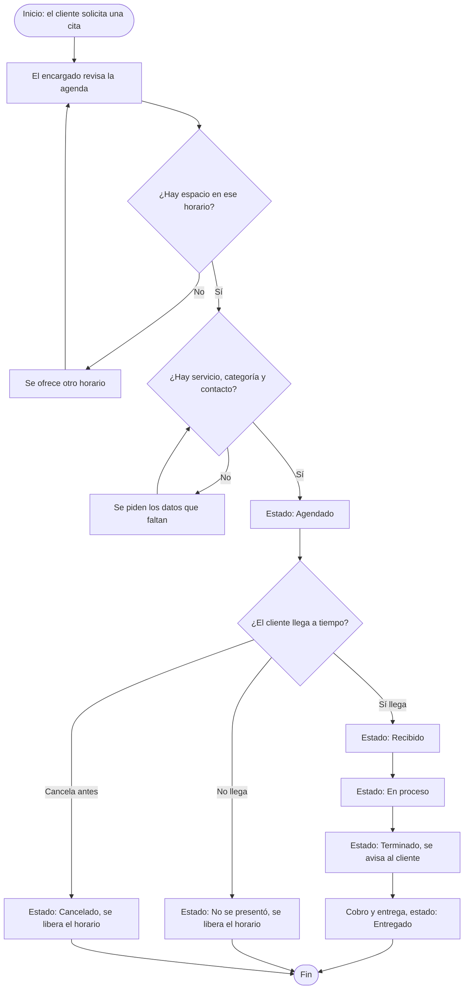
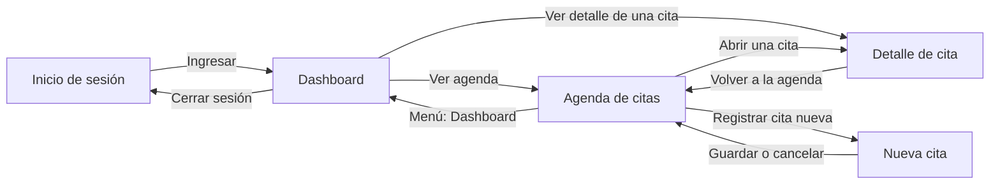

# GMV Detailing Services – Panel administrativo (Frontend)

**Materia:** Aplicaciones Web · **Grupo:** LITIID41 · **Equipo 4**
**Universidad Tecnológica de Cancún**

**Integrantes:**
- Chong González Ronald Alexis
- García Alegría Didier Alberto
- May Garrido Julián Abraham
- Fernández Peraza Braulio Darío

---

## 1. Problema

GMV Detailing Services es una microempresa de lavado y detallado de vehículos en Cancún, Quintana Roo. Atiende entre 15 y 25 clientes al día y hoy lleva su agenda en una libreta de papel. Las citas llegan por llamada, mensajes sueltos de WhatsApp o directamente al local.

Esto provoca:
- Saturación en horas pico y tiempos de espera de 45 minutos a 2 horas.
- Errores y empalmes de horarios por las anotaciones manuales.
- Turnos perdidos por clientes que no se presentan ni avisan.
- Clientes que no saben cómo va el lavado de su vehículo.

**Solución de esta entrega:** un panel web administrativo para el encargado del negocio, donde puede ver la agenda, registrar citas y cambiar el estado de cada vehículo. En esta etapa todo funciona con datos ficticios y estado local (sin base de datos, API ni autenticación real).

---

## 2. Flujo seleccionado

**Nombre del proceso:** Atención de una cita de lavado, desde la solicitud hasta la entrega del vehículo.

**Objetivo:** que cada vehículo tenga un turno claro y un estado visible durante todo el servicio.

**Quién lo inicia:** el cliente (llega, llama o escribe).
**Quién lo administra:** el encargado del negocio, desde el panel web.

**Estados:** Agendado → Recibido → En proceso → Terminado → Entregado. Salidas alternas: No se presentó y Cancelado.

**Posibles errores:** horario ocupado, datos incompletos, cliente que no llega, cancelación fuera de tiempo.



### Reglas de negocio que cambian la interfaz

| # | Regla | Efecto en la interfaz |
|---|-------|-----------------------|
| 1 | Una cita no puede usar un horario ocupado por otra cita vigente. | El formulario muestra error en "Horario". Las citas canceladas o no presentadas liberan su horario. |
| 2 | Una cita necesita al menos un servicio válido y la categoría del vehículo. | El formulario no deja guardar sin ambos. |
| 3 | Una cita en proceso o terminada no se puede cancelar. | Los botones de cancelar solo aparecen cuando el estado es "Agendado". |
| 4 | Se necesita un teléfono o un correo de contacto. | El formulario pide al menos uno de los dos. |

---

## 3. Lista de interfaces

| Interfaz | Usuario y objetivo | Datos que muestra | Acciones | Se conecta con |
|----------|--------------------|-------------------|----------|----------------|
| Inicio de sesión | Encargado; entrar al panel | Correo, contraseña, mensajes de error | Ingresar | Dashboard |
| Dashboard | Encargado; ver el día de un vistazo | Indicadores y citas pendientes de hoy | Ver detalle, ir a la agenda | Agenda, Detalle, Inicio de sesión |
| Agenda de citas | Encargado; consultar y filtrar citas | Lista de citas, estado, hora, servicios | Buscar, filtrar, abrir cita, registrar cita | Detalle, Nueva cita, Dashboard |
| Nueva cita | Encargado; registrar citas por llamada, WhatsApp o local | Formulario con cliente, contacto, vehículo, servicios, fecha y hora | Guardar, cancelar | Agenda |
| Detalle de cita | Encargado; avanzar el estado del vehículo | Datos completos de la cita y su estado | Cambiar estado, marcar no se presentó, cancelar | Agenda |

### Mapa de navegación



El encabezado con el menú aparece en todas las pantallas internas, así que desde cualquier lugar se puede ir a Dashboard, Agenda, Nueva cita o cerrar sesión.

### Bocetos de baja fidelidad

> Pendiente: agregar aquí las fotos de los bocetos y guardarlas en `docs/mockups/`.

- Inicio de sesión: `docs/mockups/login.png`
- Dashboard: `docs/mockups/dashboard.png`
- Agenda: `docs/mockups/agenda.png`
- Nueva cita: `docs/mockups/nueva-cita.png`
- Detalle de cita: `docs/mockups/detalle-cita.png`

### Capturas del prototipo

> Pendiente: capturas en 375 px, 768 px y 1280 px. Guardarlas en `docs/capturas/`.

---

## 4. Tecnologías

- React 18 + TypeScript
- Vite
- Tailwind CSS 4
- React Router 6
- HTML semántico (`header`, `nav`, `main`, `section`, `article`, `form`, `fieldset`, `dl`)

## 5. Sistema visual

| Elemento | Decisión |
|----------|----------|
| Color principal | `cyan-700` (botones, enlaces, menú activo) |
| Encabezado | `slate-900` con texto blanco |
| Fondo de página | `slate-50`; tarjetas blancas con borde `slate-300` |
| Estados | Cada estado tiene su propio color (ver `EtiquetaEstado.tsx`) |
| Errores | `red-700` / `red-800` |
| Tipografía | La del sistema que trae Tailwind |
| Foco | Anillo `cyan-700` visible en botones, enlaces y campos |
| Enfoque | Mobile first: se diseña para 375 px y se amplía con `sm:`, `md:` y `lg:` |

## 6. Estructura del proyecto

```
gmv-detailing-web/
├── docs/
│   └── mockups/
├── src/
│   ├── components/
│   │   ├── Boton.tsx
│   │   ├── CampoSelect.tsx
│   │   ├── CampoTexto.tsx
│   │   ├── EtiquetaEstado.tsx
│   │   ├── Layout.tsx
│   │   ├── Mensaje.tsx
│   │   ├── TarjetaCita.tsx
│   │   └── TarjetaIndicador.tsx
│   ├── data/
│   │   ├── citas.ts
│   │   └── servicios.ts
│   ├── pages/
│   │   ├── Agenda.tsx
│   │   ├── Dashboard.tsx
│   │   ├── DetalleCita.tsx
│   │   ├── Login.tsx
│   │   └── NuevaCita.tsx
│   ├── App.tsx
│   ├── index.css
│   ├── main.tsx
│   └── types.ts
├── index.html
├── package.json
├── tsconfig.json
└── vite.config.ts
```

## 7. Interacciones y estados de la interfaz

- **Carga simulada:** al entrar a Agenda y al iniciar sesión.
- **Vacío:** Agenda y Dashboard cuando no hay citas que mostrar.
- **Error:** inicio de sesión con datos incorrectos, formulario de nueva cita, cita no encontrada.
- **Éxito:** cita guardada y cambio de estado aplicado.
- **Confirmación:** antes de cancelar o marcar "No se presentó".
- **Accesibilidad:** `label` con `htmlFor` e `id`, `aria-invalid`, `aria-describedby`, `aria-live`, enlace "Saltar al contenido", foco visible y navegación por teclado.

## 8. Instalación y ejecución

```bash
git clone <URL-DEL-REPOSITORIO>
cd gmv-detailing-web
npm install
npm run dev
```

Abrir la dirección que muestra la terminal (normalmente `http://localhost:5173`).

**Datos de prueba para entrar:** `admin@gmv.com` / `1234`

## 9. Pruebas de responsividad

| Ancho | Revisado | Notas |
|-------|----------|-------|
| 375 px | ☐ | |
| 768 px | ☐ | |
| 1280 px | ☐ | |

## 10. Integración futura: API, base de datos SQL y app móvil

> Esta sección es teórica. No se implementa en esta entrega.

El proyecto completo se pensó como tres partes que comparten los mismos datos:

```
App móvil del cliente (Dart)  ──┐
                                ├──>  API REST  ──>  Base de datos SQL
Panel web del encargado (React) ┘
```

- **Base de datos SQL:** guardará clientes, vehículos, servicios, citas y estados. Es la fuente única de verdad.
- **API REST:** será la única forma de acceder a los datos. Ahí vivirán las reglas de negocio definitivas (por ejemplo, evitar que dos personas reserven el mismo horario).
- **App móvil del cliente:** se desarrollará más adelante en Dart con otro docente. Permitirá agendar, ver el estado del vehículo y recibir notificaciones.
- **Panel web del encargado:** es lo que contiene este repositorio.

### Cómo se preparó este frontend para esa conexión

- Los tipos de `src/types.ts` (`Cita`, `Servicio`, `EstadoCita`) describen la forma de los datos que devolverá la API.
- Los datos ficticios están en `src/data/`, separados de las pantallas. Al conectar la API se sustituirán por peticiones.
- Las funciones `cambiarEstado` y `agregarCita` están en `App.tsx`; ahí se reemplazarán por llamadas a la API.
- La carga simulada de la agenda ya contempla la espera de una petición real.
- El inicio de sesión de demostración se sustituirá por la autenticación del servidor.

## 11. Pendientes por confirmar con el negocio

- Confirmar cuántas bahías o lugares de lavado hay (el prototipo asume 1 cita por horario).
- Confirmar duración y precios reales por servicio y categoría de vehículo.
- Confirmar horario de atención, días no laborables y tolerancia antes de marcar "No se presentó".
